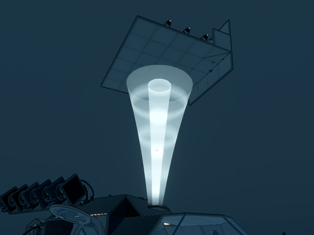
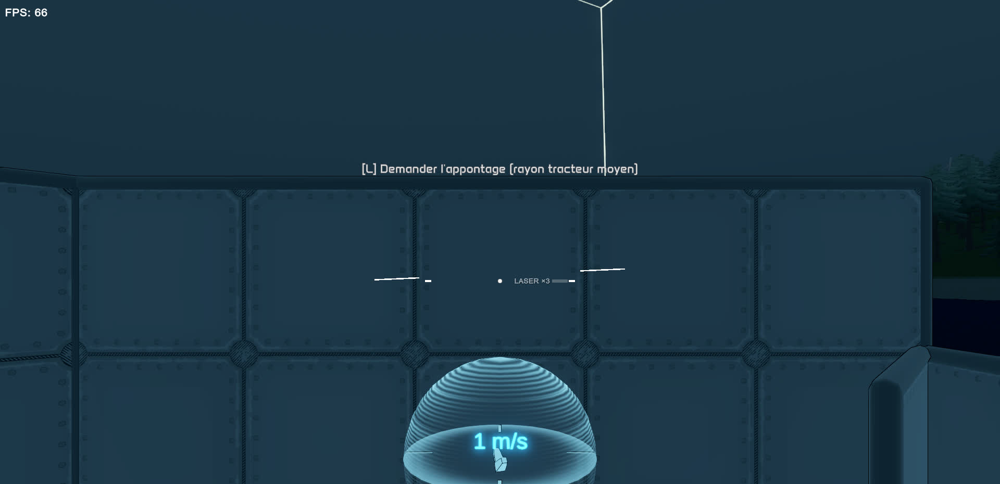
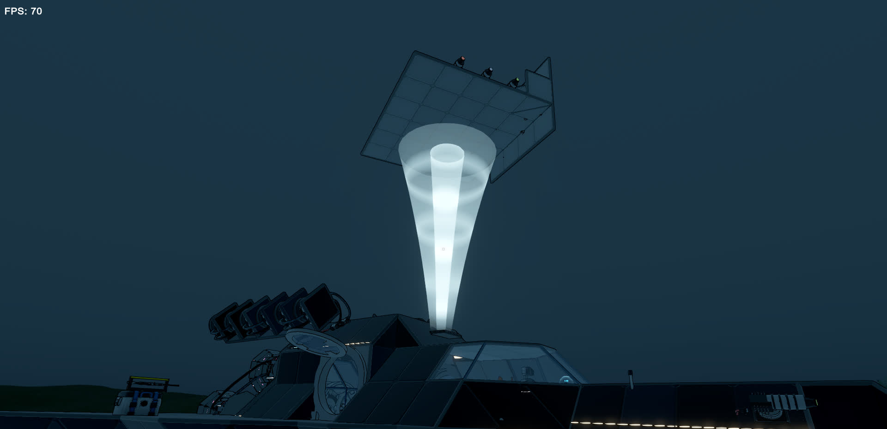

# Tractor Beam

A MelonLoader mod for **StellarDrive (Demo)**: tractor beam landing pads for big ships. A smaller ship flies into the pad's zone, the beam catches it and sets it down on the carrier, and it becomes part of the carrier until it leaves again.



## Why

A ship parked on another ship is two rigid bodies pressing on each other. Their hulls collide every physics tick, the small ship jitters, slides off when the carrier moves, and sometimes gets launched or damaged. Tractor Beam joins the landed ship to the carrier with the game's own joint system, the one docking doors and rotors use: its colliders move under the carrier's rigidbody, so the two hulls are one body and never collide. Its mass is added to the carrier's, and it rides along with the carrier wherever it goes.

## How to use it

1. Build a **Tractor beam** pad on the carrier, on a floor. It is in the build menu next to the docking door and is unlocked by the same research. The pad's size sets the biggest zone and the biggest ship it takes:

   | Pad | Biggest zone (and ship) | The zone may be moved up to |
   | --- | --- | --- |
   | Small | 12 × 12 m, 10 m high | 30 m from the pad |
   | Medium | 24 × 24 m, 18 m high | 60 m from the pad |
   | Large | 48 × 48 m, 30 m high | 120 m from the pad |

2. Press **E** on the pad to open its menu and place the landing zone: left/right, back/front and down/up from the pad, and its width, depth and height, in steps of 1 or 5 m. By default the zone stands on the pad; put it outside the hull, in front of a hangar door, under the ship... It is drawn in yellow around the carrier while the menu is open, and in blue when you come near it.
3. Fly your ship into the zone. While you pilot it, the screen shows `[L] Request landing` when the whole ship is inside.
4. Press **L**. The beam brakes the ship and carries it to the pad: straight if the way is clear, otherwise across then down, or up over the hull then across then down. It turns the ship upright, lines it up with the pad (to the nearest quarter turn) and sets it down. Its controls and thrusters are cut while it is held and while it is landed.
5. While a ship sits on a pad (or the beam is busy with one), **that pad's zone is switched off completely**: no outline, no prompt, and a ship flying into it is not caught.
6. To leave, sit at the controls and press **L** again. The ship is lifted off the pad, carried back along the same way to where the beam caught it, and released at the carrier's speed.



The key can be changed in `UserData/MelonPreferences.cfg` (`[TractorBeam] LandKey`, an Input System path such as `<Keyboard>/l`).

## What the host checks

The host decides every landing. If something is wrong, the pilot is told what:

- the whole ship must be inside the zone;
- relative speed under 12 m/s, and no fast spin;
- the ship must be lighter than the carrier and small enough for the pad (its footprint and height, plus room to hover);
- the ship must fit on the pad without touching the hull around it;
- the path must be clear: the ship's own collider boxes are tested along the way against the carrier's hull and parts, the ground, other ships and players standing in the way;
- the ship must not already be joined to another one by a docking door or a rotor, or be anchored (StellarAnchor).



## Saving and multiplayer

Landed ships are saved in `tractorbeam-docks.txt` and the pads' zones in `tractorbeam-pads.txt`, next to `world.json`. If the first file is missing, a ship found sitting in a carrier's frame with no rotor or docking door holding it is kept on the nearest free pad.

The host runs the beam and keeps the zones; every player sees them. One player at a time can open a pad's menu. The host and every player need the mod. **Launch your landed ships before removing the mod**, or they stay in the carrier's frame.

## With Ship Performance Fix

Tractor Beam runs alongside [Ship Performance Fix](https://github.com/tidic84/StellarDrive-ShipPerformanceFix). Ship Performance Fix freezes the inertia of big ships, so the carrier's inertia is recomputed one tick after a ship lands or leaves. Its corner-collider culling already ignores the colliders of a ship joined to the same body.

## Install

With [Stellar Mod Manager](https://github.com/jollyname/StellarModManager), or extract `StellarDrive-TractorBeam.zip` into the game folder (MelonLoader 0.7.x).

## Building

```bash
./build.sh    # Release build + dist/StellarDrive-TractorBeam.zip (GAME=... to point at another game folder)
```

`dev.sh` builds with `DEV`, starts the game and opens a test world; `cmd.sh` sends dev commands (see `src/TractorBeam/Dev/TractorDev.cs`): `pad`, `place`, `bring`, `land`, `launch`, `pilot`, `press`, `docks`, `where`, `cols`, `save`, `later`, `zoneset`, `bringzone`, `usepad`, `uiclick`, `shot`…
